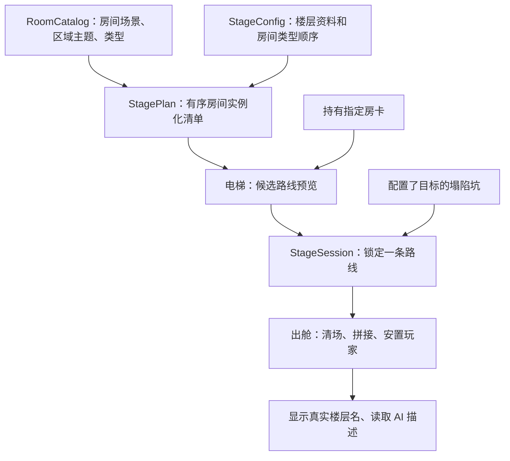

# 酒店楼层、路线预览与隐藏入口

## 运行结构

- 在 `resources/stages/hotel_room_catalog.tres` 添加房间资料。房间场景根节点继续使用现有的 `AreaSize`、相机区域和出生点约定。
- 在 `StageConfig` 设置 `FloorTheme` 和 `RoomSequence`。例如 `Begin → Combat → Combat → EliteCombat → Boss`。Boss 和出口同场时只写一个 Boss。独立出口使用 `Exit`。
- 当前 B/C/D 房间按旧池迁移。Easy、Normal、Hard 分别映射为 `Combat`、`AdvancedCombat`、`EliteCombat`。F 层固定拼接一阶段、左翼、中枢、右翼和退场。左右翼按角色池选择，当前各有一个候选。中枢为 F_boss_core，电梯预览仅显示 Boss。新增侧翼变体时，应沿用 F_boss_left 或 F_boss_right 运行时角色路径及现有轨道接缝尺寸。E 层与谜题房等新内容可按相同约定入库。
- 每份路线按实际场景资源路径在整层去重，入口、各玩法房与终点一起计算。候选交叉时可以重新分配已选位置。无法得到完整排列时，该路线不出现在电梯选项。
- 初次打开电梯选关时为候选路线生成并缓存方案。同一个来源楼层反复打开时复用方案。出舱后只实例化所选方案中的房间。目录和候选方案只保存场景路径与顺序。确认路线时只后台加载选中的房间，失败可重选。
- 当前电梯沿用数字键测试选关，每行显示一条路线。出发提示读 `ElevatorLabel`，为空显示 `？？？`。出舱、房间生成成功后，标题读 `DisplayName`。AI 快照读当前楼层的 `LevelDescription`。楼层难度仍由 `stage_difficulty` 和 `DifficultyOverride` 计算。

## 隐藏楼层

1. 新建 `StageConfig`，启用 `IsHiddenFloor`，配置楼层资料、主题与路线，加入 `StageSession.AllConfigs`。
2. 房卡入口使用 `RequiredRoomKeyItemId` 关联物品 ID。背包、快捷栏或专用装备槽持有该 ID 时，电梯显示对应隐藏路线。也可以设置 `RequiredStoryFlag`，或通过 `UnlockHiddenFloor()` 授予资格。房卡默认保留。
3. 塌陷入口使用 `FallRegion.HiddenFloorDestinations`。在需要作为入口的深坑中填入候选隐藏楼层。坠落开始时从有效候选中随机选择一层并后台加载。动画结束且资源就绪后提交，超时走普通坠落回退。换层接管玩家传送，普通坠落回退和扣血不执行。目标为空或无法生成时执行原坠落流程。
4. 当前隐藏楼层出口根据来源楼层推导下一站。返回原楼层并保留清怪、拾取、机关状态需要另行接入房间状态保存。隐藏楼层可以再次进入，是否限制访问由入口规则决定。

现有 `stage_eggA.tres` 已迁移为隐藏楼层，房卡资源为 `RoomKey_HiddenA.tres`。测试可通过 F3 解锁，具体关卡中的房卡掉落和塌陷点位由关卡配置决定。F 层正式条件分支的目标和剧情条件仍需内容配置。

可将房卡场景 scenes/items/room_key_hidden_a.tscn 放入房间或用作掉落。

- Stage_home 使用 StandaloneStage 配置启动路线。Stage_2、Stage_3、Stage_4 和 Stage_test 的独立场景已移除。酒店由 StageSession 提交路线。生成器与配置资源均已移除旧五池和房间数量字段。

Ordinary routes use RandomMiddleRooms mode and filter the catalog by FloorTheme and eligible middle-room types (Combat, AdvancedCombat, EliteCombat, Puzzle). MiddleRoomRouteTag is optional and restricts the shared pool to rooms with a matching RouteTags entry. BeginScenePath and EndScenePath are fixed and excluded from the middle pool. The full route is deduplicated by scene path, and the elevator previews the actual chosen order. Ordered mode uses RoomSequence.
